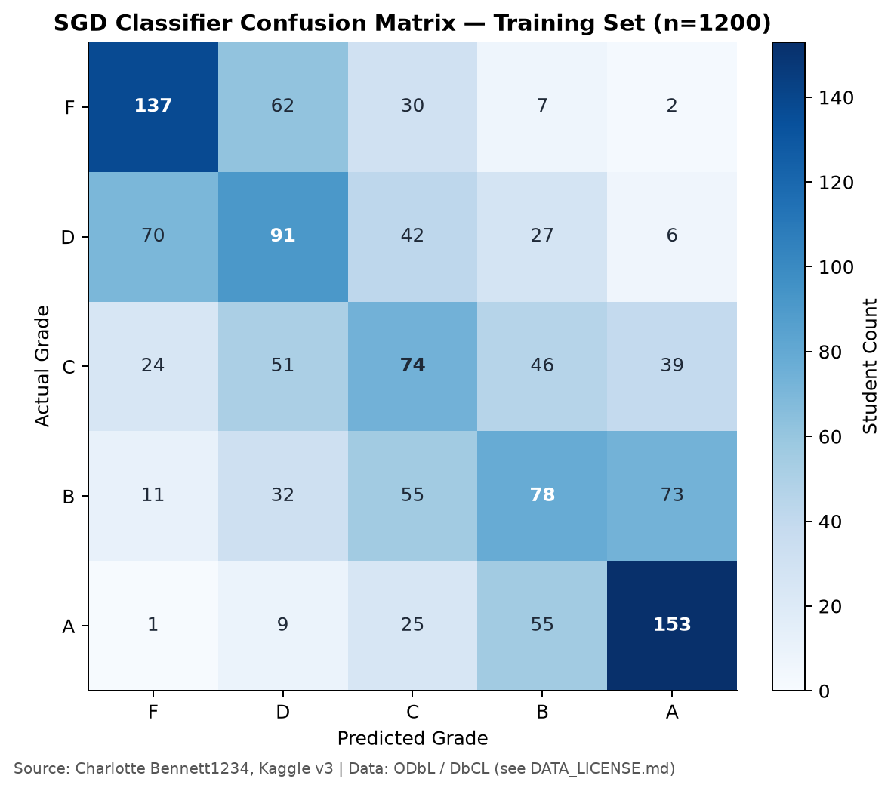
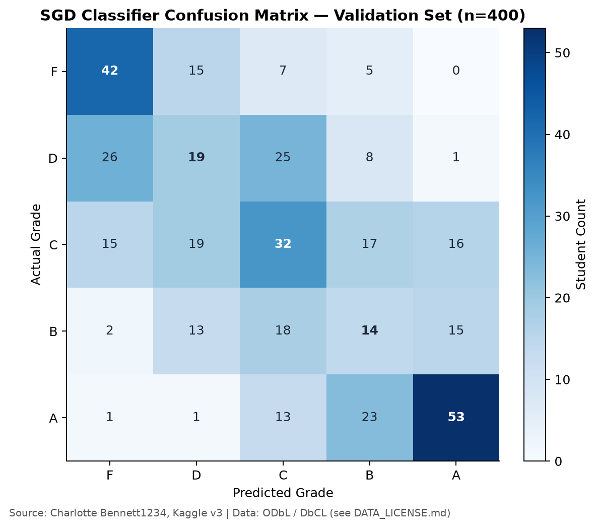
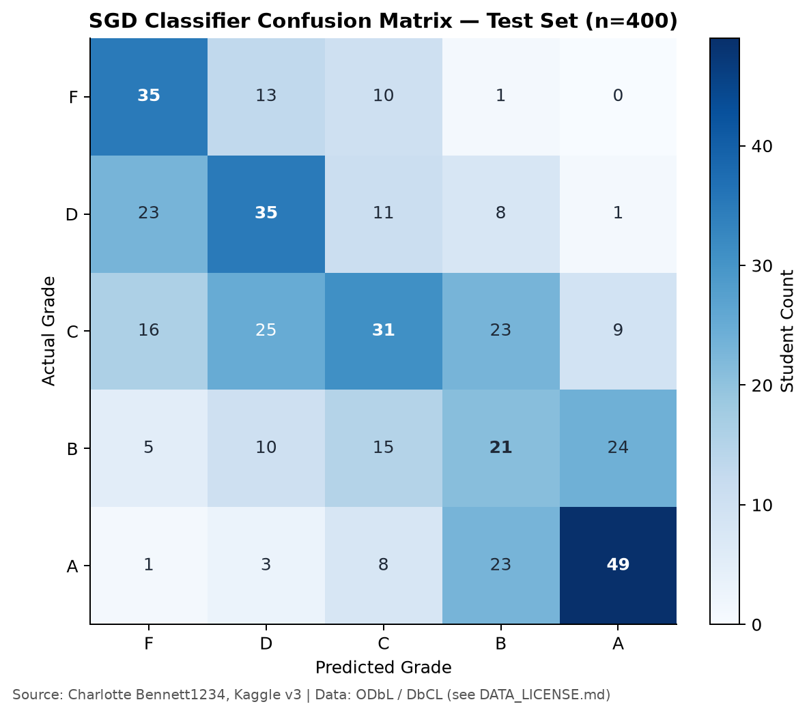

# GE2340 Data Analysis and Baseline Results

Technical evidence | 13 November 2026 | Regression and classification method verified against submitted Phase 1

This report documents the dataset, exploratory analysis, experimental settings and baseline results for the team report. Data preparation for continuous prediction is complete, and Section 6 defines the classification target. The regression method matches the submitted Phase 1 proposal. The classification method is complete at section 7.

## 1 Dataset and data quality

- Source: *Lifestyle Factors and Their Impact on Students*, Charlotte Bennett1234, Kaggle version 3. The original file contains 2,000 rows and 9 columns.
- The outcome, `Grades`, retains its original units and ranges from 5.60–10.00 in the full dataset.
- Predictors: `Study_Hours_Per_Day`, `Extracurricular_Hours_Per_Day`, `Sleep_Hours_Per_Day`, `Social_Hours_Per_Day` and `Physical_Activity_Hours_Per_Day`. Each measures hours per day.
- `Student_ID` identifies records only. `Gender` and `Stress_Level` are excluded to match the five-input Phase 1 plan.

| Quality check | Result |
|---|---|
| Missing cells in the original file | 0 |
| Exact duplicate rows / duplicate student IDs | 0 / 0 |
| Rows removed / imputed | 0 / 0 |
| Clean observations retained | 2,000 |
| Daily durations | All five sum to 24 within floating-point tolerance |

We checked the schema, numeric values for finiteness, ID uniqueness and whether durations fell within 0–24 hours. All observations were retained without imputation. Training-set interquartile range (IQR) flags identify potential outliers.

Evidence: [quality_audit.json](outputs/quality_audit.json); [student_lifestyle_dataset..csv](data/raw/student_lifestyle_dataset..csv); [run_pipeline.py](src/run_pipeline.py).

## 2 Data preparation and descriptive statistics

- With a fixed random seed of 2340, we reserved 20% of observations for testing. Of the remaining 80%, 25% were assigned to validation. This left 1,200 training, 400 validation and 400 test observations.
- Exploratory plots and correlations use only the training set. `StandardScaler` was fitted to the training predictors, then applied unchanged to the validation and test sets. `Grades` was not standardized.
- The shared data exports retain all five predictors. The linear baseline alone uses four, with physical activity as the reference activity.

| Training variable | Mean | Sample SD | Min | Max |
|---|---:|---:|---:|---:|
| Study | 7.494 | 1.442 | 5.000 | 10.000 |
| Extracurricular | 1.984 | 1.136 | 0.000 | 4.000 |
| Sleep | 7.496 | 1.459 | 5.000 | 10.000 |
| Social | 2.720 | 1.702 | 0.000 | 6.000 |
| Physical activity | 4.306 | 2.475 | 0.000 | 13.000 |
| Grades | 7.777 | 0.763 | 5.600 | 9.820 |

Training sample n = 1,200. Durations are measured in hours/day, and Grades retains its original units. Sample SD uses n−1 as the denominator. StandardScaler uses the population convention, so the SD values above differ from its scaling parameters.

**Figure 1.** Training distributions, showing the observed ranges and shapes.

## 3 Exploratory relationships and interpretation

**Figure 2.** Training Pearson correlations, n = 1,200. Source attribution appears on the figure.

| Predictor | Correlation with Grades |
|---|---:|
| Study | 0.7391 |
| Physical activity | −0.3614 |
| Social | −0.1009 |
| Extracurricular | 0.0024 |
| Sleep | −0.0015 |

- Among the measured predictors, study time has the strongest positive linear association with Grades. Sleep and extracurricular time have near-zero marginal correlations with Grades.
- Because the activities total 24 hours, increasing one requires reducing one or more others. Study and physical activity have a correlation of −0.5115.

Evidence: [train_correlations.csv](outputs/train_correlations.csv). The [scatter-plot figure](outputs/figures/03_relationships_train.png) in the original package provides a complementary view of these same training observations.

## 4 Linear regression and baseline evaluation

- The mean baseline predicts 7.777125 for every observation. This is the mean Grades value among the 1,200 training observations.
- We fitted the linear model with scikit-learn `LinearRegression`, using an intercept and ordinary least squares (OLS). The squared-error objective matches the mean squared error (MSE) objective in the submitted Phase 1 proposal. The model uses unstandardized training hours and returns raw predictions in the original Grades units.
- The five durations sum to 24, and their centered training matrix has rank 4. Setting physical activity as the reference removes coefficient redundancy. Its information is retained through the total-time constraint.

| Split | Model | MAE | RMSE | R² |
|---|---|---:|---:|---:|
| train | linear regression | 0.4067 | 0.5131 | 0.5474 |
| train | mean baseline | 0.6234 | 0.7626 | 0.0000 |
| validation | linear regression | 0.4104 | 0.5183 | 0.5147 |
| validation | mean baseline | 0.6049 | 0.7442 | -0.0005 |
| test | linear regression | 0.3725 | 0.4731 | 0.5403 |
| test | mean baseline | 0.5659 | 0.6994 | -0.0044 |

MAE measures mean absolute prediction error, and RMSE measures root mean squared error. Both are expressed in the original Grades units, with lower values indicating smaller errors. R² compares squared prediction error against predicting the evaluation set’s own mean. Higher R² is better; negative values are possible.

- On the test set, linear regression had an MAE of 0.372452, compared with 0.565948 for the mean baseline. This represents a reduction of about 34.2%. Test R² was 0.540324.
- Training and validation MAE were 0.406691 and 0.410385. The model produced similar prediction errors on these two sets.

`Phase1_Proposal.pdf`, page 1, specifies mean squared error and obtains the best-fit parameters by setting the derivative to zero. The OLS method used here follows that objective.

## 5 Validation diagnostics and experiment status

**Figure 3.** Validation diagnostics, n = 400. Residuals are observed minus predicted Grades.

- The dataset’s original collection method and real or synthetic provenance remain unverified.
- The OLS model and mean baseline have been evaluated on the fixed data split.
- Section 6 defines the classification target and the majority-baseline class results. This is used to compare against section 7, which has the softmax results, including classification accuracy and Macro-F1.

### Evidence and source references

Primary dataset: Charlotte Bennett1234. [Lifestyle Factors and Their Impact on Students](https://www.kaggle.com/datasets/charlottebennett1234/lifestyle-factors-and-their-impact-on-students). Kaggle, version 3.

Dataset license terms: [Open Database License 1.0](https://opendatacommons.org/licenses/odbl/1-0/) and [Database Contents License 1.0](https://opendatacommons.org/licenses/dbcl/1-0/). Figures and derived tables retain source attribution.

Reproducible evidence: [metrics.csv](outputs/metrics.csv); [regression_model.json](outputs/regression_model.json); [train_descriptive_statistics.csv](outputs/train_descriptive_statistics.csv); [train_correlations.csv](outputs/train_correlations.csv); [split_manifest.csv](outputs/processed/split_manifest.csv); [preprocessor.json](outputs/processed/preprocessor.json); [run_pipeline.py](src/run_pipeline.py). Raw source metadata and the executable pipeline are included in the data package.

### Project status

- The grade bands in Section 6 are fixed.
- The regression baseline uses the squared-error OLS objective and four predictors under the fixed 24-hour constraint.

## 6 Project-defined classification target

The project defines relative grade bands from the training distribution. F denotes the lowest relative group, not an official failure category.

The training 20th, 40th, 60th and 80th percentiles are 7.10, 7.55, 8.00 and 8.45. We applied these fixed boundaries unchanged to validation and test observations. Equal scores share a label, so group sizes may differ.

| Band | Grades interval | Train | Validation | Test |
|---|---|---:|---:|---:|
| F | Grades < 7.10 | 238 | 69 | 59 |
| D | 7.10 ≤ Grades < 7.55 | 236 | 79 | 78 |
| C | 7.55 ≤ Grades < 8.00 | 234 | 99 | 104 |
| B | 8.00 ≤ Grades < 8.45 | 249 | 62 | 75 |
| A | Grades ≥ 8.45 | 243 | 91 | 84 |

The intervals above define the classification labels.

The boundaries were computed from training data. The v1 test regression results had already been inspected when classification was added.

The shared data package contains the split, preprocessing parameters and classification labels.

### Majority-class baseline

The majority-class baseline always predicts B, the most frequent training class (249 of 1,200). It provides a reference for evaluating subsequent classifiers.

| Split | Accuracy | Macro-F1 | Balanced accuracy |
|---|---:|---:|---:|
| train | 20.75% | 0.06874 | 0.20 |
| validation | 15.50% | 0.05368 | 0.20 |
| test | 18.75% | 0.06316 | 0.20 |

Macro-F1 gives equal weight to each class. Balanced accuracy is mean class recall. Evidence: [class_counts.csv](outputs/class_counts.csv) and [classification_metrics.csv](outputs/classification_metrics.csv) in v2.

## 7 Multi-class linear classifier and baseline evaluation

### Model methods and settings
- Given that the 5 different predictors are correlated with each other, as they sum up to 24 hours, these predictors are strongly correlated with each other. Hence, we will use a multi-class linear classifier that fits a linear model in a non-linear (polynomial) feature space.
- We fitted the multi-class linear classifier with scikit-learn `SGDClassifier`. In particular, we first built a pipeline to expand the predictors to include squared and interaction terms, resulting in a total of 20 internal features. Hence, while the model itself is linear, the decision boundary for the grades produced is non-linear.
- The model uses `loss='log_loss'`, which enables the model to optimize the cross-entropy loss via the softmax function across all 5 grades. It contains both L1 and L2 regularization, with weights of 0.15 and 0.85, respectively, and the regularization strength is set to `alpha='0.001'`. The learning rate of the model remains fixed at 0.005 to ensure convergence, and the decision boundary for the middle grades (D - B) is slightly expanded to accommodate more students. Finally, the model runs for 3000 iterations. Such specifications match the implementation details from phase 1, with additional internal features to further strengthen the classifier's decision boundaries.
- During the model training process, the validation data showed some grades concentrated in certain grades. (e.g., Grades A and F were large sinkholes, encompassing a majority of the students, leading to sparse population in the middle grades.) or some grades completely collapsed. Hence, the `class_weight={...}` was iteratively modified to increase the weight of the intermediate grades (D-B) and slightly reduce the weight of the extreme grades (F & A). This gives the final `class_weight` as follows:
`'F': 1.0 | 'D': 1.3 | 'C': 1.4 | 'B': 1.4 | 'A': 0.9`

### Results and figures
After training the model, the model's confusion matrices for the training, validation, and test sets, and the model's metrics are as follows:

| Training Set | Validation Set | Test Set |
|---|---|---|
|  |  | 

**Figure 4a, 4b and 4c.** Confusion matrices for the training set, validation set and the test set. Source attribution appears on the figure. 

| Split | Model | Accuracy | Macro-F1 | Balanced accuracy |
|---|---|---:|---:|---:|
| train | multi-class linear classifier | 0.4441 | 0.4400 | 0.4440 |
| validation | multi-class linear classifier | 0.4000 | 0.3902 | 0.3961 |
| test | multi-class linear classifier | 0.4275 | 0.4283 | 0.4406 |

Comparing it with the majority-class baseline:

| Split | Accuracy | Macro-F1 | Balanced accuracy |
|---|---:|---:|---:|
| train | 20.75% | 0.06874 | 0.20 |
| validation | 15.50% | 0.05368 | 0.20 |
| test | 18.75% | 0.06316 | 0.20 |

We can derive the following observations:

### Discussion: Observation
- On the test set, the multi-class linear classifier had an Accuracy, Macro-F1, and Balanced Accuracy of 0.4275, 0.4283, and 0.4406, respectively. Compared with 0.1875, 0.06316, and 0.20 for the majority-class baseline, this shows an improvement of over 100% across all statistics, with the Macro-F1 showing the greatest improvement of around 579%. This indicates that the classifier successfully learned the dataset's features and was able to assign students to the correct grade tiers more precisely overall than blindly assigning all students to the same grade, as described in the majority-class baseline.
- Both the train set and the validation set share fairly similar Accuracy, Macro-F1, and Balanced Accuracy, with a small drop-off of around 10%. This shows that the model did not suffer from underfitting or overfitting and was able to generalize well to the data.
- In the case of the classifier failing to put a student into the correct grade boundaries, the classifier also tends to put them into the next nearest grade boundaries. For example, if the student's actual grade is C, the classifier usually assigns them a grade of D or B. This can be observed in the confusion matrices for the training, validation, and test sets, indicating that the model exhibits a fairly strong diagonal relationship.

### Discussion: Model differences
- Compared to the linear regression model described above, which predicts the student's grade by a single grade point, using the multi-class linear classifier frames the problem as classifying students into a finite, discrete number of categories. This shift allows direct control over class boundaries via `class_weight`, which helps alleviate the grade sinkhole and collapse problems.
- As concluded in `Phase1_Proposal.pdf`, page 2, a multi-class linear classifier is more suited. Its ability to determine the exact grade value, rather than a fixed number from linear regression, provides stronger insight for the target audience. Hence, the end product (the website and the exe file) will preferably use the classification model rather than the regression model.

### Discussion: Model limitations
- The classifier model optimizes the cross-entropy loss using a standard softmax activation function. Hence, it treats the grade categories as independent. This results in the same loss incurred when the classifier incorrectly predicts whether the grade difference is large. Hence, an improved loss objective could penalize the model less if it predicts incorrectly but the grade difference is small, or vice versa.
- Even though the model has generally better performance over the majority-baseline class, its accuracy is still relatively low. This is because students in the intermediate grades tend to have similar time allocations. This results in the classifier making fairly close predictions for those grades, effectively turning it into an equal-probability gamble. While including those squared terms and interaction terms helped improve accuracy slightly, it is by no means a fully effective remedy for the classifier's low accuracy.

Reproducible evidence: [sgd_classification_metrics.csv](outputs/sgd_classification_metrics.csv); [sgd_confusion_test.csv](outputs/sgd_confusion_test.csv); [sgd_confusion_train.csv](outputs/sgd_confusion_train.csv); [sgd_confusion_validation.csv](outputs/sgd_confusion_validation.csv); [run_pipeline.py](src/run_pipeline.py). Raw source metadata and the executable pipeline are included in the data package.
