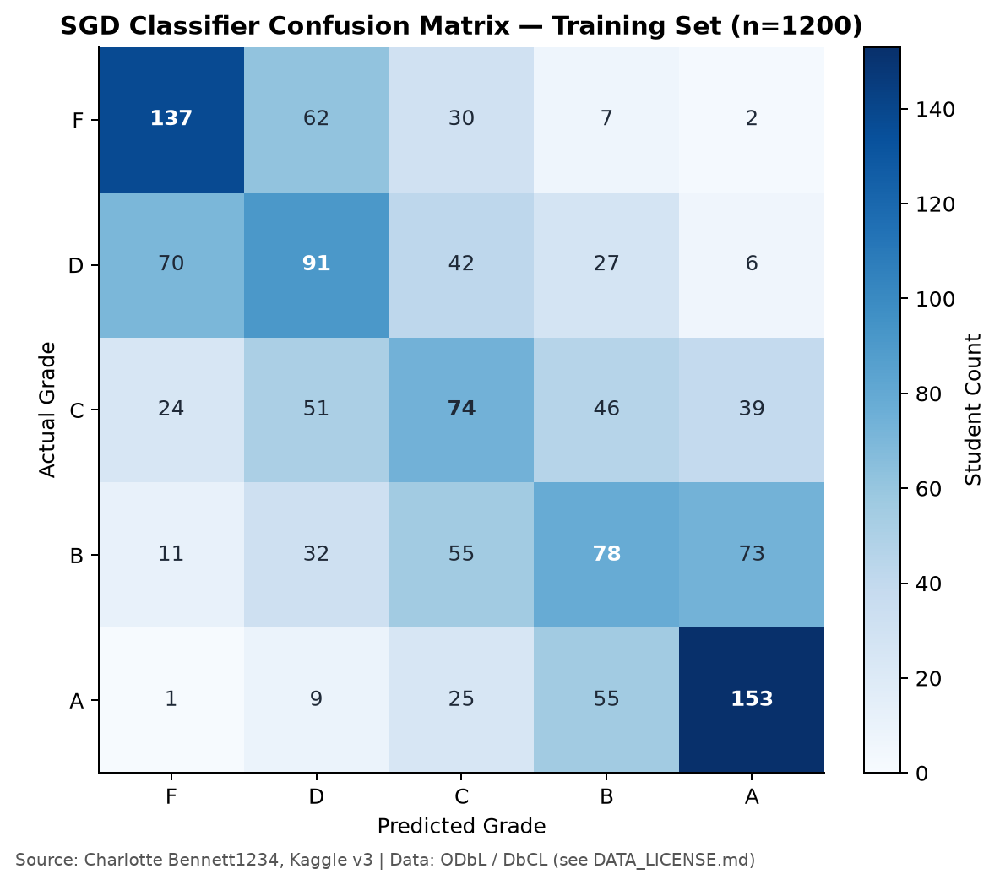
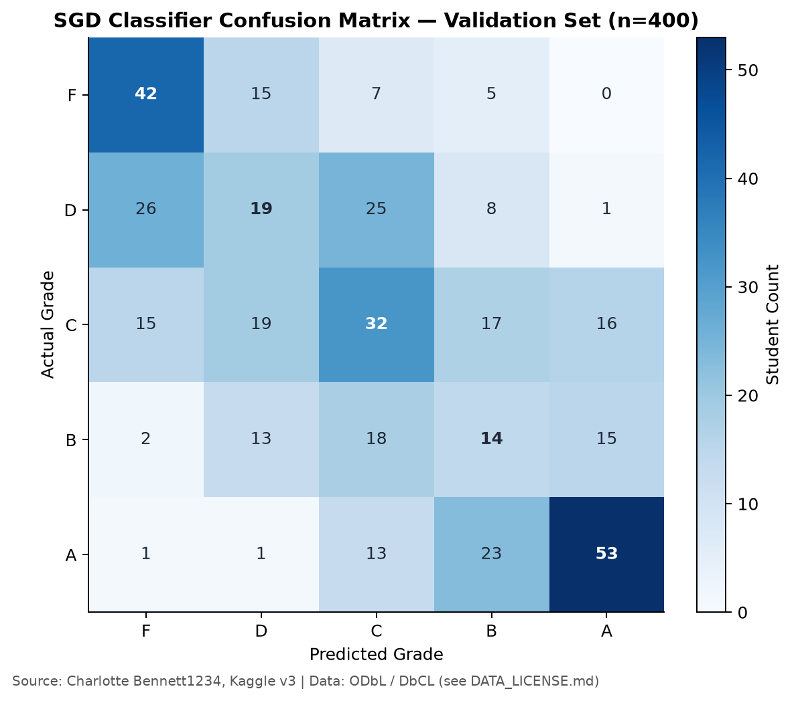
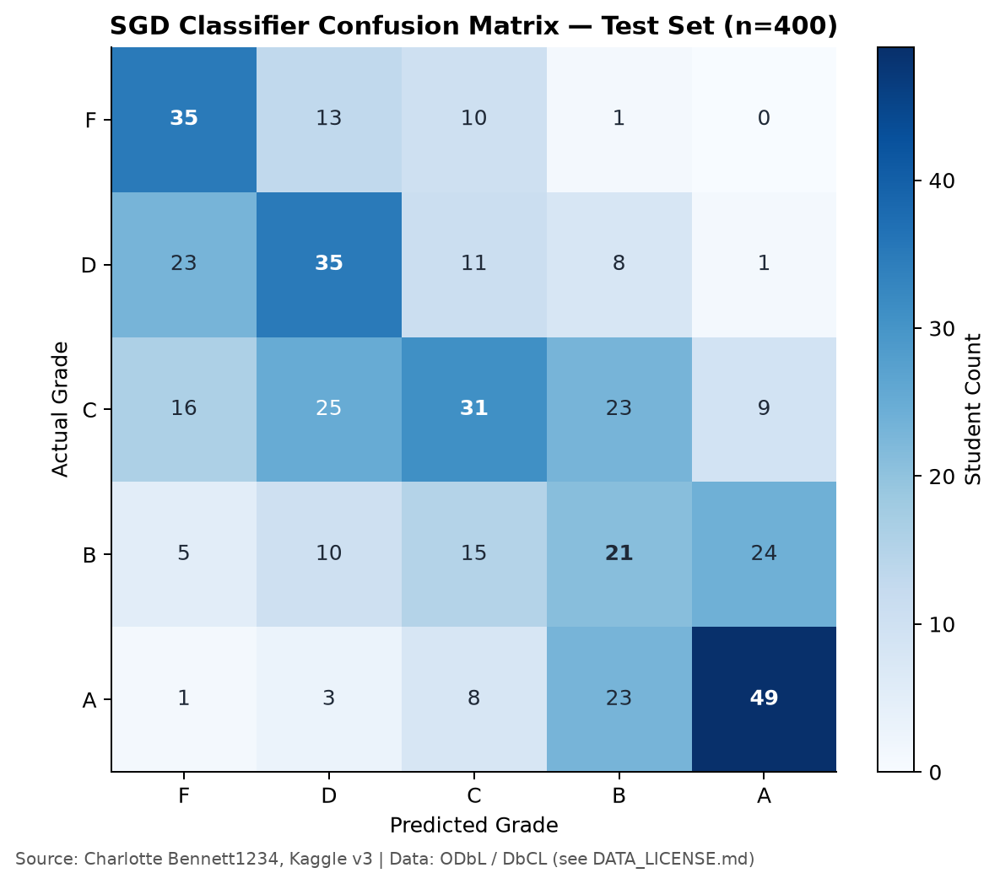

# GE2340 Data Analysis and Baseline Results

Technical evidence | 13 November 2026 | Regression and classification methods verified against the submitted Phase 1 proposal

The hours in a student's day are fixed in total, so time given to one activity is taken from others. This report asks how the division of those hours among five activities relates to grades, and whether it supports grade prediction beyond simple baselines. The analysis forms the technical basis of the team report. Sections 1 to 3 describe the data, its preparation and the exploratory analysis. Section 4 evaluates a linear regression model against a mean baseline, using the method specified in the Phase 1 proposal. Section 5 recasts the problem as five-class classification and evaluates a linear classifier against a majority-class baseline.

## 1 Dataset and data quality

The data come from the Kaggle dataset *Lifestyle Factors and Their Impact on Students* (Charlotte Bennett1234, version 3). Each of its 2,000 rows describes one student through nine variables. The target is `Grades`, a continuous score between 5.60 and 10.00, which we analyze on its original scale. The Phase 1 proposal specified five inputs, all recorded in hours per day: `Study_Hours_Per_Day`, `Extracurricular_Hours_Per_Day`, `Sleep_Hours_Per_Day`, `Social_Hours_Per_Day` and `Physical_Activity_Hours_Per_Day`. The other three columns play no part in modeling. `Student_ID` only labels each row, and `Gender` and `Stress_Level` lie outside the Phase 1 design.

Data quality was assessed before any preprocessing. The audit covered the column schema, the finiteness of numeric entries, the uniqueness of student IDs and the 0–24 hour range of each duration. Table 1 lists the outcomes. The file had no missing cells and no duplicated rows or IDs. In every row, the five durations added up to 24 hours up to floating-point error. Since nothing required correction, all 2,000 rows entered the analysis unchanged.

**Table 1.** Outcome of the data quality audit.

| Quality check | Result |
|---|---|
| Missing cells in the original file | 0 |
| Exact duplicate rows / duplicate student IDs | 0 / 0 |
| Rows removed / imputed | 0 / 0 |
| Clean observations retained | 2,000 |
| Daily durations | All five sum to 24 within floating-point tolerance |

Outliers were screened but not removed. Training observations beyond the interquartile range (IQR) limits were flagged for reference, and all of them stayed in the data. The audit code is in [run_pipeline.py](src/run_pipeline.py), the raw input is [student_lifestyle_dataset..csv](data/raw/student_lifestyle_dataset..csv), and the audit output is [quality_audit.json](outputs/quality_audit.json).

## 2 Data preparation and descriptive statistics

We partitioned the observations once, with the random seed fixed at 2340 so that the split can be reproduced. A first split reserved 20% of the data as the test set. A second split moved 25% of the remainder into a validation set. The final partition holds 1,200 training, 400 validation and 400 test observations. To keep the evaluation sets unseen, all exploratory work used training data alone. For the same reason, `StandardScaler` learned its parameters from the training predictors only and was then applied, without refitting, to the validation and test sets. `Grades` stayed unscaled.

The exported data files carry all five predictors, so the regression and classification models draw on identical observations. The regression model nonetheless enters only four of them and treats physical activity as the reference category. Section 4.1 gives the reason, which lies in the fixed daily total. Table 2 profiles the training set.

**Table 2.** Summary statistics of the training set (n = 1,200). Durations are in hours per day; Grades are on the original scale.

| Training variable | Mean | Sample SD | Min | Max |
|---|---:|---:|---:|---:|
| Study | 7.494 | 1.442 | 5.000 | 10.000 |
| Extracurricular | 1.984 | 1.136 | 0.000 | 4.000 |
| Sleep | 7.496 | 1.459 | 5.000 | 10.000 |
| Social | 2.720 | 1.702 | 0.000 | 6.000 |
| Physical activity | 4.306 | 2.475 | 0.000 | 13.000 |
| Grades | 7.777 | 0.763 | 5.600 | 9.820 |

Two conventions for the standard deviation appear in this work. Table 2 uses the sample SD, with n − 1 in the denominator, whereas `StandardScaler` divides by n. The scaler's parameters therefore do not match the values in Table 2 exactly. Figure 1 plots the full distribution of each variable. Study, extracurricular, sleep and social time spread across their ranges without a pronounced peak. Physical activity is right-skewed, and Grades are unimodal.

**Figure 1.** Distribution of each training variable (n = 1,200).

## 3 Exploratory relationships and interpretation

**Figure 2.** Pearson correlation matrix of the training variables (n = 1,200). Source attribution appears on the figure.

**Table 3.** Correlation of each predictor with Grades in the training set, ordered by magnitude.

| Predictor | Correlation with Grades |
|---|---:|
| Study | 0.7391 |
| Physical activity | −0.3614 |
| Social | −0.1009 |
| Extracurricular | 0.0024 |
| Sleep | −0.0015 |

Study time is the only predictor with a strong association with Grades (r = 0.7391; Table 3). Physical activity shows a moderate negative correlation (r = −0.3614) and social time a weak one (r = −0.1009). Sleep and extracurricular time are essentially uncorrelated with Grades (r = −0.0015 and r = 0.0024). These marginal correlations need to be read in light of the 24-hour constraint. A student who studies more must spend less time on something else, and Figure 2 shows a negative correlation between study time and physical activity (r = −0.5115). The same constraint makes the five predictors exactly collinear, which Section 4.1 resolves by using physical activity as the reference. All coefficients here measure association, not causation. They are stored in [train_correlations.csv](outputs/train_correlations.csv), and the [scatter-plot figure](outputs/figures/03_relationships_train.png) displays each activity against Grades.

## 4 Linear regression and baseline evaluation

### 4.1 Model methods and settings

The regression analysis tests whether time allocation predicts Grades better than a constant does. The constant benchmark is the training mean, 7.777125, assigned to every student. The model is an ordinary least squares (OLS) linear regression with an intercept, implemented with scikit-learn `LinearRegression`. It is fitted on raw hours rather than standardized values, so its predictions are on the Grades scale.

Fitting all five durations would leave the model unidentified. Because each row sums to 24 hours, the centered training design matrix has rank 4. With an intercept present, one of the five coefficients is therefore redundant. We omit physical activity and fit the remaining four predictors. No information is lost, since physical activity equals 24 hours minus the other four. Estimation minimizes the mean squared error (MSE), the objective set out in `Phase1_Proposal.pdf` (p. 1). The parameters follow from setting its derivative to zero.

### 4.2 Results and baseline comparison

Three metrics quantify predictive performance. Mean absolute error (MAE) averages the absolute prediction errors. Root mean squared error (RMSE) is the square root of the mean squared error and weights large errors more heavily. Both are expressed in Grades units, and lower values are better. The coefficient of determination (R²) measures the reduction in squared error relative to predicting the evaluation set's own mean. It falls below zero when a model does worse than that mean. Table 4 reports all three metrics for both models on each split.

**Table 4.** Linear regression and mean baseline performance by split.

| Split | Model | MAE | RMSE | R² |
|---|---|---:|---:|---:|
| train | linear regression | 0.4067 | 0.5131 | 0.5474 |
| train | mean baseline | 0.6234 | 0.7626 | 0.0000 |
| validation | linear regression | 0.4104 | 0.5183 | 0.5147 |
| validation | mean baseline | 0.6049 | 0.7442 | -0.0005 |
| test | linear regression | 0.3725 | 0.4731 | 0.5403 |
| test | mean baseline | 0.5659 | 0.6994 | -0.0044 |

Linear regression has lower MAE and RMSE and higher R² than the mean baseline on all three splits. The baseline's R² is zero on the training set by construction. Its small negative values on the validation and test sets reflect the gap between the training mean and each set's own mean.

### 4.3 Validation diagnostics

Figure 3 examines the validation errors in two ways. The left panel plots predictions against observed grades, and points on the dashed diagonal would indicate perfect prediction. The predictions cover a narrower range than the observed grades, so low grades tend to be overestimated and high grades underestimated. The right panel plots residuals against predictions. The residuals scatter around zero, with no clear trend or change in spread across the predicted range.

**Figure 3.** Validation diagnostics for linear regression (n = 400). Left: predicted versus observed Grades. Right: residuals (observed minus predicted Grades) versus predicted Grades.

### 4.4 Discussion

Against the mean baseline, linear regression lowers test MAE from 0.565948 to 0.372452, a reduction of about 34.2%, and attains a test R² of 0.540324 (Table 4). On this split, the activity predictors therefore carry information about Grades that a constant prediction cannot capture. The model also performs consistently across subsets. Training MAE (0.406691) and validation MAE (0.410385) are nearly identical, which gives no indication of overfitting. The narrowed prediction range in Figure 3 suggests that the remaining error is concentrated among students with unusually high or low grades.

## 5 Multi-class classification and baseline evaluation

### 5.1 Classification target and grade bands

The classification task replaces the continuous target with five ordered grade bands. The band boundaries are the 20th, 40th, 60th and 80th percentiles of the training grades: 7.10, 7.55, 8.00 and 8.45. They were set once on the training data and applied unchanged to the validation and test sets. Students with equal grades always share a band, so band sizes are not exactly equal (Table 5). The bands are relative to this sample. F marks its lowest-scoring group and does not denote a failing grade in any official sense.

**Table 5.** Grade bands and their frequencies in each split.

| Band | Grades interval | Train | Validation | Test |
|---|---|---:|---:|---:|
| F | Grades < 7.10 | 238 | 69 | 59 |
| D | 7.10 ≤ Grades < 7.55 | 236 | 79 | 78 |
| C | 7.55 ≤ Grades < 8.00 | 234 | 99 | 104 |
| B | 8.00 ≤ Grades < 8.45 | 249 | 62 | 75 |
| A | Grades ≥ 8.45 | 243 | 91 | 84 |

The shared package distributes the labels together with the split and the fitted preprocessing parameters. One caveat concerns timing. The boundaries depend on training data alone, but the classification task was added only after the test-set results of the v1 regression had been inspected.

### 5.2 Majority-class baseline

The majority-class baseline sets the minimum standard for the classifier. It assigns every student to the most frequent training band, B, which holds 249 of the 1,200 training observations. Table 6 gives its scores, against which the classifier is judged in Sections 5.4 and 5.5.

**Table 6.** Majority-class baseline performance by split.

| Split | Accuracy | Macro-F1 | Balanced accuracy |
|---|---:|---:|---:|
| train | 20.75% | 0.06874 | 0.20 |
| validation | 15.50% | 0.05368 | 0.20 |
| test | 18.75% | 0.06316 | 0.20 |

Accuracy alone can overstate the performance of a model that favors large classes. We therefore also report Macro-F1, the unweighted mean of the per-class F1 scores, and balanced accuracy, the mean of the per-class recall values. For a constant predictor over five classes, balanced accuracy is 0.20 by construction. Class counts and baseline metrics are stored in [class_counts.csv](outputs/class_counts.csv) and [classification_metrics.csv](outputs/classification_metrics.csv) (v2).

### 5.3 Model methods and settings
- Given that the 5 different predictors are correlated with each other, as they sum up to 24 hours, these predictors are strongly correlated with each other. Hence, we will use a multi-class linear classifier that fits a linear model in a non-linear (polynomial) feature space.
- We fitted the multi-class linear classifier with scikit-learn `SGDClassifier`. In particular, we first built a pipeline to expand the predictors to include squared and interaction terms, resulting in a total of 20 internal features. Hence, while the model itself is linear, the decision boundary for the grades produced is non-linear.
- The model uses `loss='log_loss'`, which enables the model to optimize the cross-entropy loss via the softmax function across all 5 grades. It contains both L1 and L2 regularization, with weights of 0.15 and 0.85, respectively, and the regularization strength is set to `alpha='0.001'`. The learning rate of the model remains fixed at 0.005 to ensure convergence, and the decision boundary for the middle grades (D - B) is slightly expanded to accommodate more students. Finally, the model runs for 3000 iterations. Such specifications match the implementation details from phase 1, with additional internal features to further strengthen the classifier's decision boundaries.
- During the model training process, the validation data showed some grades concentrated in certain grades. (e.g., Grades A and F were large sinkholes, encompassing a majority of the students, leading to sparse population in the middle grades.) or some grades completely collapsed. Hence, the `class_weight={...}` was iteratively modified to increase the weight of the intermediate grades (D-B) and slightly reduce the weight of the extreme grades (F & A). This gives the final `class_weight` as follows:
`'F': 1.0 | 'D': 1.3 | 'C': 1.4 | 'B': 1.4 | 'A': 0.9`

### 5.4 Results and baseline comparison
After training the model, the model's confusion matrices for the training, validation, and test sets, and the model's metrics are as follows:

| Training Set | Validation Set | Test Set |
|---|---|---|
|  |  | 

**Figure 4a, 4b and 4c.** Confusion matrices for the training set, validation set and the test set. Source attribution appears on the figure. 

| Split | Model | Accuracy | Macro-F1 | Balanced accuracy |
|---|---|---:|---:|---:|
| train | multi-class linear classifier | 0.4441 | 0.4400 | 0.4440 |
| validation | multi-class linear classifier | 0.4000 | 0.3902 | 0.3961 |
| test | multi-class linear classifier | 0.4275 | 0.4283 | 0.4406 |

Comparing it with the majority-class baseline:

| Split | Accuracy | Macro-F1 | Balanced accuracy |
|---|---:|---:|---:|
| train | 20.75% | 0.06874 | 0.20 |
| validation | 15.50% | 0.05368 | 0.20 |
| test | 18.75% | 0.06316 | 0.20 |

We can derive the following observations:

### 5.5 Discussion and limitations

#### Observations
- On the test set, the multi-class linear classifier had an Accuracy, Macro-F1, and Balanced Accuracy of 0.4275, 0.4283, and 0.4406, respectively. Compared with 0.1875, 0.06316, and 0.20 for the majority-class baseline, this shows an improvement of over 100% across all statistics, with the Macro-F1 showing the greatest improvement of around 579%. This indicates that the classifier successfully learned the dataset's features and was able to assign students to the correct grade tiers more precisely overall than blindly assigning all students to the same grade, as described in the majority-class baseline.
- Both the train set and the validation set share fairly similar Accuracy, Macro-F1, and Balanced Accuracy, with a small drop-off of around 10%. This shows that the model did not suffer from underfitting or overfitting and was able to generalize well to the data.
- In the case of the classifier failing to put a student into the correct grade boundaries, the classifier also tends to put them into the next nearest grade boundaries. For example, if the student's actual grade is C, the classifier usually assigns them a grade of D or B. This can be observed in the confusion matrices for the training, validation, and test sets, indicating that the model exhibits a fairly strong diagonal relationship.

#### Model differences
- Compared to the linear regression model described above, which predicts the student's grade by a single grade point, using the multi-class linear classifier frames the problem as classifying students into a finite, discrete number of categories. This shift allows direct control over class boundaries via `class_weight`, which helps alleviate the grade sinkhole and collapse problems.
- As concluded in `Phase1_Proposal.pdf`, page 2, a multi-class linear classifier is more suited. Its ability to determine the exact grade value, rather than a fixed number from linear regression, provides stronger insight for the target audience. Hence, the end product (the website and the exe file) will preferably use the classification model rather than the regression model.

#### Model limitations
- The classifier model optimizes the cross-entropy loss using a standard softmax activation function. Hence, it treats the grade categories as independent. This results in the same loss incurred when the classifier incorrectly predicts whether the grade difference is large. Hence, an improved loss objective could penalize the model less if it predicts incorrectly but the grade difference is small, or vice versa.
- Even though the model has generally better performance over the majority-baseline class, its accuracy is still relatively low. This is because students in the intermediate grades tend to have similar time allocations. This results in the classifier making fairly close predictions for those grades, effectively turning it into an equal-probability gamble. While including those squared terms and interaction terms helped improve accuracy slightly, it is by no means a fully effective remedy for the classifier's low accuracy.

## 6 Evidence and source references

**Dataset.** Charlotte Bennett1234. [Lifestyle Factors and Their Impact on Students](https://www.kaggle.com/datasets/charlottebennett1234/lifestyle-factors-and-their-impact-on-students) (version 3). Kaggle.

**License.** The dataset is released under the [Open Database License 1.0](https://opendatacommons.org/licenses/odbl/1-0/) and the [Database Contents License 1.0](https://opendatacommons.org/licenses/dbcl/1-0/). Every figure and derived table carries source attribution.

**Reproducibility materials, Sections 1 to 4.** [metrics.csv](outputs/metrics.csv); [regression_model.json](outputs/regression_model.json); [train_descriptive_statistics.csv](outputs/train_descriptive_statistics.csv); [train_correlations.csv](outputs/train_correlations.csv); [split_manifest.csv](outputs/processed/split_manifest.csv); [preprocessor.json](outputs/processed/preprocessor.json); [run_pipeline.py](src/run_pipeline.py).

**Reproducibility materials, Section 5.** [sgd_classification_metrics.csv](outputs/sgd_classification_metrics.csv); [sgd_confusion_test.csv](outputs/sgd_confusion_test.csv); [sgd_confusion_train.csv](outputs/sgd_confusion_train.csv); [sgd_confusion_validation.csv](outputs/sgd_confusion_validation.csv); [run_pipeline.py](src/run_pipeline.py).

The data package also contains the raw source metadata and the executable pipeline.
